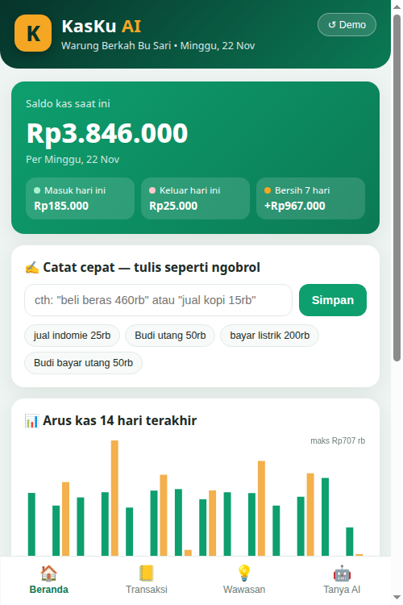
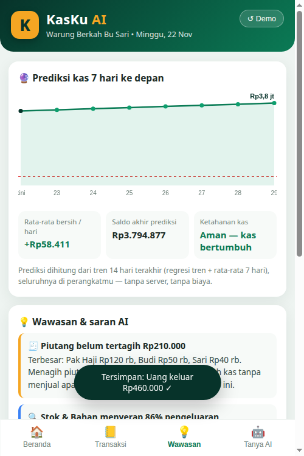
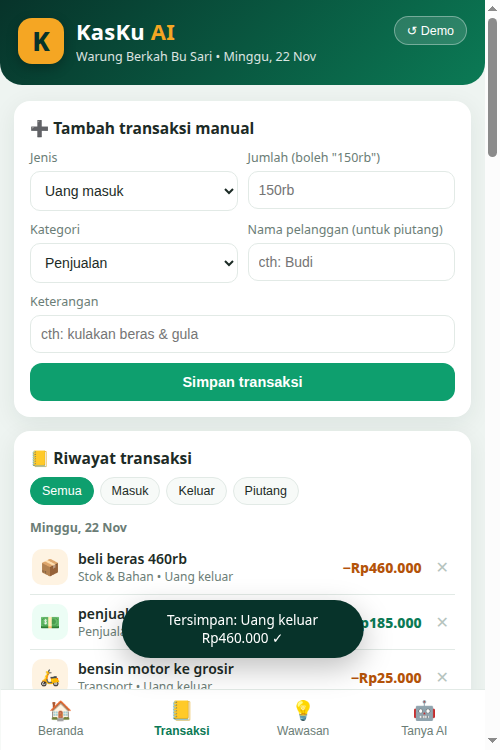
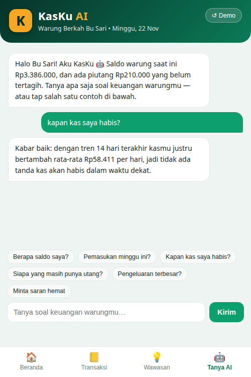

# KasKu AI — a cash-flow copilot for Indonesian warung & micro-businesses

> **"Catat seperti ngobrol, KasKu yang berpikir."**
> Type your transactions the way you'd say them — KasKu AI turns everyday Indonesian
> into a live cash book, a 7-day cash forecast, and concrete money advice.



## The problem

Indonesia has **60+ million micro and small businesses** — warung (small shops), food
stalls, kiosks. Most owners still track money in a paper notebook, or not at all.
The result is painfully predictable:

- They don't know today's real cash position.
- Stock purchases and daily sales blur together, so "busy" days still end cash-negative.
- Customer credit (*utang*) lives in memory — and quietly leaks thousands of rupiah.
- Nobody warns them that cash will run out **before** it actually does.

Accounting apps exist, but they ask for categories, forms, and bookkeeping discipline
that a warung owner serving customers simply doesn't have time for.

## The solution

**KasKu AI** is a mobile-first web app that meets owners where they are:

### 1. ✍️ Natural-language bookkeeping (Bahasa Indonesia)
Type like you talk — KasKu parses amount, direction, category, and even customer names:

| You type | KasKu understands |
|---|---|
| `jual kopi 15rb` | income Rp15.000 |
| `beli beras 460rb` | expense Rp460.000, category *Stok & Bahan* |
| `bayar listrik 200rb` | expense, category *Operasional* |
| `Budi utang 50rb` | receivable from Budi Rp50.000 |
| `Budi bayar utang 50rb` | Budi's debt settled → cash in |

It handles Indonesian money shorthand natively: `50rb`, `50 ribu`, `15k`, `1,5jt`,
`Rp50.000`, `150.000`.

### 2. 🔮 7-day cash forecast & runway warning
A trend-aware model (least-squares trend blended with the 7-day mean of daily net cash)
projects the balance a week ahead and estimates **how many days the cash will last** —
the single most actionable number for a micro-business.

### 3. 💡 An insight engine that reads *your* numbers
Not generic tips — computed advice: uncollected receivables with names and amounts,
week-over-week sales movement, the expense category eating your margin, your best
sales weekday, and a painless daily savings suggestion when cash flow is healthy.

### 4. 🤖 "Tanya KasKu" — ask your own books anything
A conversational assistant over the ledger: *"Berapa saldo saya?"*, *"Kapan kas saya
habis?"*, *"Siapa yang masih punya utang?"*, *"Pengeluaran terbesar?"* — answered
instantly from the owner's real data.





## How the AI works — and why it runs 100% on-device

KasKu's intelligence is a purpose-built engine in `logic.js` (~600 lines, zero
dependencies):

- **NLP parser** — Indonesian amount grammar (rb/ribu/k/jt/juta, dot-grouped rupiah),
  intent verbs (*jual/beli/bayar/utang*), keyword categorization, and person
  extraction for credit tracking.
- **Forecasting** — daily-net series → least-squares trend blended with a 7-day mean,
  projected 7 days out with a runway estimate.
- **Insight rules** — thresholded detectors over the owner's aggregates
  (receivables, category share, WoW deltas, weekday seasonality).
- **Chat brain** — intent matching over the same aggregates, always answering with
  the owner's actual numbers.

**Responsible by design:** everything runs in the browser. Financial data lives in
`localStorage` on the owner's own phone — no server, no account, no tracking, no API
costs, and it works on the patchy connections many warungs have. For financial data
this sensitive, *not* sending it to the cloud is the feature.

## Tech stack

- Vanilla **HTML / CSS / JavaScript** — no build step, no framework, no dependencies.
- Canvas-rendered charts (cash-flow bars, forecast line), hand-rolled.
- `localStorage` persistence; seeded with two weeks of realistic demo data
  ("Warung Berkah Bu Sari") so judges can explore immediately.
- `logic.js` is environment-agnostic (browser + Node) and covered by **45 unit tests**.

## Run it

```bash
# any static server, or just open the file
open index.html
# or
npx serve .
```

Then try: type `beli beras 460rb` in *Catat cepat*, open **Wawasan** for the forecast
and insights, and ask **Tanya AI**: *"kapan kas saya habis?"*

## Tests

```bash
node test/logic.test.js   # 45 checks: amount parsing, NLP entry, ledger math,
                          # receivables, forecast, insights, chat answers
```

## Project structure

```
index.html    app shell — 4 views: Beranda, Transaksi, Wawasan, Tanya AI
styles.css    mobile-first design system
app.js        UI layer: state, rendering, charts, chat
logic.js      the AI engine (parser, forecast, insights, chat brain)
test/         headless unit tests for logic.js
shots/        screenshots
```

## Roadmap

- WhatsApp-style voice-note entry (speech → the same NLP parser)
- Photo receipt OCR for stock purchases
- Multi-shop support and printable weekly reports for loan (KUR) applications
- Optional cloud sync with end-to-end encryption

## Author

**Batar Sentuh** — built for **SLAY HACKS 2026** (Devpost).

## License

MIT — see [LICENSE](LICENSE).
